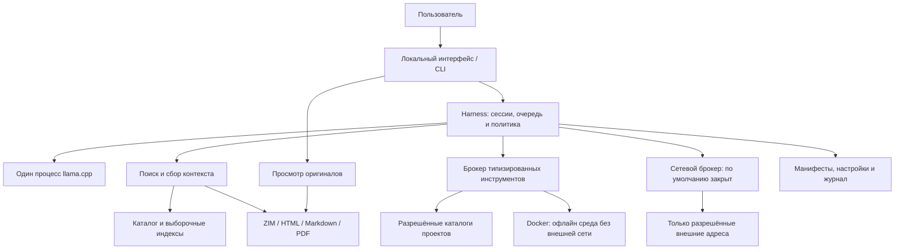

# Local AI Guru — архитектура

Статус: интегрированный проект архитектуры, 28 октября 2026 года. Четыре отчёта R&D прочитаны и сверены; существенные расхождения и решения приведены ниже. Приложение, установщик и офлайн-комплекты ещё не реализованы и не проверены на целевой машине. Точные загрузки, версии компонентов, размеры корпусов и показатели производительности подлежат валидации; вместимость полного комплекта в 100 GB пока не доказана. План работ и критерии приёмки: [PLAN.md](PLAN.md).

## 1. Назначение и обязательные свойства

Local AI Guru — помощник для экстренного кодинга и браузер локальных знаний под Windows. Целевая машина: Ryzen 5 5600X, 16 ГБ оперативной памяти, RTX 3060 с 12 ГБ видеопамяти. Система должна запускаться после подготовки без доступа к интернету и без облачного сервиса, входа в аккаунт или VPN. VPN и изменение VPN на компьютере не входят в архитектуру.

Подтверждено пользователем в текущей сессии: проект личный и некоммерческий. Требования к коммерчески разрешительному распространению нет. Лицензии моделей и источников всё равно проверяются на соответствие фактическому использованию; наличие специальных условий само по себе не исключает кандидата.

Пользователь сообщил, что на Windows уже есть WSL, и предложил использовать его. Наличие WSL — пользовательское сообщение, а не результат диагностики; версия, дистрибутив, режим WSL2, CUDA и ограничения не проверены. Первая гипотеза развёртывания — llama.cpp, harness и dev environments внутри WSL2, интерфейс в браузере Windows; native Windows остаётся запасным вариантом.

Пользователь может читать оригиналы документов без участия модели, искать по библиотеке, получать ответы со ссылками на конкретные локальные источники, разбирать код и скриншоты, создавать изменения в разрешённом проекте и запускать проверенные инструменты в подготовленной среде.

Обязательные решения:

- Инференс только через llama.cpp; загружаемые с Hugging Face модели в GGUF, с проверкой происхождения и лицензии. Наличие файла в Hugging Face само по себе не доказывает открытость лицензии.
- Локальный harness управляет сессией, retrieval, инструментами, политиками доступа и жизненным циклом моделей. Текст модели никогда не является разрешением доступа.
- Интернет выключен при каждом запуске. Включение — отдельной явной командой пользователя с областью действия; политика не зависит от того, есть ли сеть на компьютере.
- Настраиваемые списки разрешённых доменов, корней файловой системы и инструментов проверяются вне модели. Приложение показывает, какие ограничения обеспечены harness, а какие подтверждены ОС или контейнером.
- Программная документация, Wikipedia, iFixit, кулинария, первая помощь, медицинская библиотека и выживание поставляются независимыми пакетами. Для каждого пакета фиксируются источник, версия, дата и условия использования.
- Подготовленный Docker-образ считается полезным только вместе с доказанно доступными офлайн зависимостями, инструментами и примерами сборки.
- Вариант uncensored/Heretic-style и vision-профиль предусмотрены отдельно. Точное значение названия Heretic, происхождение производных моделей и совместимые артефакты остаются вопросами исследования.

## 2. Компоненты и границы

Проектное решение для первого прототипа: небольшой сервис на Rust, SQLite для каталога/полнотекстового поиска, заранее собранный интерфейс Vue и CLI для диагностики. Сначала оценить Linux-сервис и CUDA-сборку llama.cpp внутри существующего WSL, если P1 подтвердит WSL2. Начать с loopback-интерфейса для браузера Windows; отдельную desktop-оболочку пока не выбирать. Выбор компонентов — предложение Planner, а не историческое требование пользователя. До реализации проверить транспорт, границы reader и доступный офлайн браузер в P1. Запуск готового интерфейса не должен требовать Node.js, npm, dev-server или CDN; зависимость от загружаемого при первом запуске WebView недопустима.

| Вариант | Приоритет и условия выбора | Что остаётся обязательным |
| --- | --- | --- |
| WSL2: llama.cpp + harness + dev environments | Первая проверяемая гипотеза, учитывая уже установленный WSL. Для контейнеров оценить Docker Engine непосредственно в guest; Docker Desktop не является обязательной зависимостью | CUDA и библиотеки, ограничение процессов/файлов/сети guest, локальный транспорт в Windows, полный offline restore |
| Native Windows runtime/harness | Запасной вариант, если WSL2/CUDA, IPC или ограничения не проходят P1 | Отдельная Windows CUDA-сборка и граница Windows workers; Linux-контейнеры dev environments всё равно проверяются отдельно |

Основание гипотезы, официальные источники проверены Org 28.10.2026: [NVIDIA CUDA on WSL](https://docs.nvidia.com/cuda/wsl-user-guide/index.html) описывает CUDA inference в WSL2 на поддерживаемых NVIDIA GPU с совместимым Windows driver; [Microsoft WSL networking](https://learn.microsoft.com/en-us/windows/wsl/networking) описывает доступ Windows к Linux-серверу через localhost при стандартном NAT; [Microsoft GPU compute](https://learn.microsoft.com/en-us/windows/wsl/tutorials/gpu-compute) допускает Docker Engine непосредственно в WSL. Это основания проверить вариант, не доказательство работы выбранной сборки на этой машине. Обновление driver/WSL, установка engine и изменение сетевого режима сейчас не выполняются.



| Компонент | Ответственность | Ограничение |
| --- | --- | --- |
| Интерфейс и CLI | Диалог, поиск, просмотр источников, команды политики, очередь задач | Только локальные ресурсы; внешние ссылки не открываются автоматически |
| Harness | Бюджет контекста, вызовы модели, валидация инструментов, переключение профилей | Единственный владелец полномочий и разрешений |
| llama.cpp | Генерация текста и обработка изображения совместимой моделью | Получает локальные пути; не получает shell, ключи сети или полномочия менеджера пакетов |
| Retrieval | Поиск в выбранных коллекциях, фильтры версии/языка, выдача фрагментов | Источники трактуются как данные, включая инструкции внутри документов |
| Хранилище | Неизменяемые оригиналы, метаданные, восстанавливаемые индексы | Удаление индекса не удаляет источник |
| Инструменты | Чтение файлов, подготовка патча, разрешённые сборка и тест | Отдельные схемы аргументов, корни, лимиты времени и вывода |
| Сетевой брокер | Загрузка явно выбранного ресурса или обновления после команды | Не предоставляет модели произвольный HTTP-прокси или туннель |
| Менеджер пакетов | Импорт, проверка целостности, staging, активация и откат | Не активирует неполный пакет и не обновляется в фоне |

Интерфейс доступен через loopback, без публикации на LAN по умолчанию. Inference API доступен только harness; UI получает лишь необходимые операции через него. Harness использует сессионный токен, проверяет Origin/Host и не доверяет доступности localhost как механизму авторизации. Исходные HTML/PDF/ZIM открываются в отдельной ограниченной области без доступа к управляющим API и проектным файлам. Активный JavaScript в оригиналах выключен по умолчанию; внешние ресурсы и переходы запрещены до разрешённой операции брокера. Токен управления не передаётся reader и не помещается в URL цитаты. Обычная вкладка браузера и отдельный origin сами по себе не доказывают отсутствие egress: сетевые запросы reader входят в проверку границы ОС. Если выбранная изоляция мешает loopback-транспорту, в P1 сравнить ограниченный локальный канал с IPC; не выдавать широкое сетевое исключение ради работоспособности UI.

## 3. Модели и память

### Основной профиль и очередь

Первая стратегия — **одна современная multimodal модель для text/coding/RU и vision**, а не обязательная пара text-only + отдельная VLM. Пользователей максимум 1–2; начально один active inference slot и очередь с отдельной историей/полномочиями каждой сессии. Второй пользователь не создаёт второй resident model или параллельный KV автоматически. Операционный disk ceiling — 100 GB со всеми временными расходами. Это не разрешает публикацию на LAN: исходный frontend остаётся локальным, доступ с другого устройства требует отдельного решения.

| Профиль | Назначение | Условие включения |
| --- | --- | --- |
| `multimodal-default` | Код, русские/английские ответы по источникам, скриншоты и изображения | Одна проверенная пара language GGUF + совместимый mmproj, один runtime процесс; text и image проверены на той же сборке |
| `text-specialist` / отдельный `vision` | Необязательная стратегия, если одна VLM заметно уступает специализированному text/code профилю | Измеренное преимущество оправдывает дополнительные файлы и переключения; обязательная vision-возможность сохраняется |
| `text-alternative` | Необязательная uncensored/Heretic-style производная | Проверены точная база/изменения/лицензия; дополнительных прав на инструменты нет |
| `embedding` | Необязательный семантический поиск | Измерена польза относительно полнотекстового поиска и память; не обязателен для старта |

### Обновлённый shortlist на 28.10.2026

Проверка старых файлов не была проверкой свежести рынка. Qwen2.5-Coder-7B, Qwen3-8B, Qwen2.5-VL-3B и Gemma 3 4B переведены в **legacy baselines, без загрузки по умолчанию**. Новый отчёт с release evidence, полными file names, исключениями и уровнями уверенности: [models.md](docs/research/models.md). Пользователь предпочитает Unsloth-конверсии и требует сравнение с Gemma; автор базы и её лицензия учитываются отдельно от автора GGUF.

| Роль | Кандидат и выбранный начальный набор | Основание / ограничение |
| --- | --- | --- |
| A1, первый опыт | `Qwen/Qwen3.5-9B` → `unsloth/Qwen3.5-9B-GGUF`: Q4_K_M 5.68 GB + F16 mmproj 918 MB ≈ 6.60 GB | Unified coding/tool/RU/vision гипотеза, не победитель benchmark. [Qwen News](https://github.com/QwenLM/Qwen3.8#news) прямо датирует малые 4B/9B **02.03.2026**; февральская citation семейства не является датой 9B |
| A2, обязательное сравнение | `google/gemma-4-E4B-it` → `unsloth/gemma-4-E4B-it-GGUF`: Q4_K_M 4.98 GB + F16 mmproj 990 MB ≈ 5.97 GB | Gemma обязательно проходит те же coding/tool/RU/vision fixtures. [Google release log](https://ai.google.dev/gemma/docs/releases): **31.03.2026**, launch article от 02.04.2026. У Gemma **4** Apache-2.0, не условия Gemma 3 |
| B1/B2, уменьшение нагрузки | Qwen3.5-4B Unsloth Q4_K_M + F16 ≈ 3.41 GB; Gemma 4 E2B Unsloth Q4_K_M + F16 ≈ 4.10 GB | При провале ресурсов/задержки или обоснованном сравнении. Effective E2B/E4B не равен всем хранимым параметрам, использовать полный набор файлов |
| C, code/tool специализация | IBM Granite 4.2 8B / 3B publisher GGUF Q4_K_M 5.35 / 2.24 GB | [Релиз IBM 25.08.2026](https://research.ibm.com/blog/introducing-granite-4-2), text-only; не закрывает vision, RU не входит в tested languages. Только при необходимости отдельного text comparator |

Первичные file listings, проверенные 28.10.2026: [Qwen 9B](https://huggingface.co/unsloth/Qwen3.5-9B-GGUF/tree/main), [Qwen 4B](https://huggingface.co/unsloth/Qwen3.5-4B-GGUF/tree/main), [Gemma E4B](https://huggingface.co/unsloth/gemma-4-E4B-it-GGUF/tree/main), [Gemma E2B](https://huggingface.co/unsloth/gemma-4-E2B-it-GGUF/tree/main). Размеры округлены сайтом, в **десятичных GB/MB**, суммы расчётные; они не определяют VRAM/installed bytes. Релиз, происхождение и наличие файлов подтверждены; local fit/скорость/качество не установлены. Перед загрузкой нужны immutable revisions базы и конверсии, LICENSE/NOTICE, точные bytes/SHA-256 и один выбранный projector.

Qwen3.6/3.8 не превращаются в малые модели по более новому имени: проверенные официальные релизы крупнее первого бюджета. Qwen3.8-27B сохраняется как conditional поздний dense offload опыт после exact footprint/runtime/budget, без утверждения о невозможности. 30B+ MoE не выбирать по active 3B: хранятся все эксперты. Gemma 4 26B A4B также не является E4B. Дополнительные актуальные альтернативы и причины невключения в первые лоты — в отчёте; это bounded shortlist, не заявление о полном покрытии всех релизов.

### Runtime evidence и quant policy

Для Qwen3.5 подтверждён [upstream text implementation](https://github.com/ggml-org/llama.cpp/blob/master/src/models/qwen35.cpp), включая 4B/9B. [Unsloth guide](https://unsloth.ai/docs/models/qwen3.5) даёт llama.cpp 9B инструкции и family mmproj guidance. Generic mtmd docs не перечисляют имя Qwen3.5: это не доказательство отсутствия поддержки, но точный vision путь/сборка/CUDA/WSL2 остаются проверкой P1. Для Gemma 4 E2B/E4B есть прямое перечисление в [upstream multimodal docs](https://github.com/ggml-org/llama.cpp/blob/master/docs/multimodal.md). Все источники проверены 28.10.2026. Наличие source/support инструкции не равно успешному запуску выбранной пары.

P1 закрепляет один llama.cpp release/commit и guest CUDA dependencies, template и parser; минимальный пригодный build не выдумывается по generic HF app snippets. Text и image операции должны пройти на одной закреплённой сборке. GGUF и mmproj не взаимозаменяемы между авторами/ревизиями по похожему имени; Google official QAT — отдельный возможный comparator, а не комплект файлов для смешивания с Unsloth. Продукт использует локальные пути, без auto-fetch; MTP/draft assets в baseline не входят.

Начать A1/A2 со standard Q4_K_M, Q4/Q5 — основные quality baselines. Q3 остаётся optional экспериментом против меньшей Q4/Q5 на точных code/tool задачах, Q2 — последним по приоритету при отдельной необходимости; никакого автоматического downgrade после OOM. При запасе ресурсов и проблемах качества сравнить **9B Q5_K_M/Q6_K против 4B Q8_0** на тех же задачах. Q8 меньшей модели не гарантирует лучшего ответа. По [Qwen 9B Files](https://huggingface.co/unsloth/Qwen3.5-9B-GGUF/tree/main), Q8_0 9.53 GB + F16 projector 0.918 GB ≈ **10.45 GB до KV/recurrent state, image tokens, buffers и Windows reserve**: на 12 GB VRAM fit не обещается. Это только optional diagnostic после resource pass. Unsloth UD-Q4_K_XL и standard Q4_K_M сравниваются по фактическим задачам, не по имени uploader; дополнительные quants и Google QAT не скачиваются всем набором. Точные quant sizes/варианты приведены в отчёте.

### Большие кандидаты и RAM offload

По новой команде пользователя большие модели исследуются как отдельный поздний опыт: сначала Gemma 4 12B Unified Q4_K_M +F16 (7296977280 remote bytes), затем при необходимости Ministral 3 14B Q4_K_M +F16 (9117121376 bytes). Один constrained MoE — Qwen3.6-35B-A3B: Q4+F16 сначала проходит budget gate (23033812672 bytes), Q3_K_S +F16 (16258479808 bytes) только optional опыт против меньшей Q4/Q5 модели; его active 3B не заменяет 35B total. Default компактная пара A1/A2 сохраняется; большие модели не объявляются ни невозможными, ни пригодными без resource/quality evidence. Exact файлы, релизы, API metadata и варианты Q4/Q2 — [offload.md](docs/research/offload.md).

Раздельно проверяются CPU-resident weights (числовой ngl), live KV на CPU/RAM и precision KV. Они конкурируют за одну RAM guest и имеют разные latency/quality tradeoffs; перемещение KV не освобождает память весов. В P1-O менять по одному фактору, фиксировать fit/ctx/template, без silent fallback неподдержанного hybrid/FA случая. 16 ГБ Windows RAM +12 ГБ VRAM не являются свободным общим пулом; WSL limit, Windows reserve и disk-backed swap учитываются. Пользователь отложил target Windows тесты: сейчас только документы и локальные dry-run/synthetic проверки подготовленного runner, без inference benchmark на текущем host.

### Планирование ресурсов

Для первого прогона: 1–2 пользователя через очередь, один активный запрос, контекст 4–8K токенов как исследуемый диапазон, ограниченная выдача retrieval, без параллельной индексации и тяжёлой сборки. Контекст выбранной модели может потребовать другого минимума. Длина, заявленная в карточке модели, не равна доступной длине на этой машине.

Оценка веса для dense-модели: `число параметров × эффективные биты / 8`, плюс служебные данные и смешанная точность. Например, сырые 8B × 4 бита дают около 4 GB, но конкретный Q4-файл обычно больше этой нижней оценки. Это расчёт, не замер файла и не оценка всей VRAM. Для MoE учитывать все хранимые веса, а не только активные параметры.

Полный бюджет VRAM: веса + KV-cache + compute buffers + vision encoder/projector + визуальные токены + запас Windows/дисплея. KV зависит от архитектуры, контекста, типа данных и параллельных слотов; его нельзя вывести только из числа параметров. Предварительный резерв под дисплей/драйвер и колебания — 1,5–2,5 GiB, затем уточнить замером. Кандидат должен оставлять измеренный запас и проходить длинный запрос, а не только загружаться.

16 ГБ RAM — отдельное ограничение: Windows, browser/UI, файловый cache, mmap модели, WSL и JVM конкурируют за память. Предварительно ограничивать guest/контейнеры и запускать одну тяжёлую задачу. Ранее намеченные 4–6 GiB для WSL относятся лишь к dev-профилю при остановленном inference; при переносе самой модели в guest этот лимит нельзя считать подходящим без измерения. В P1 снять guest memory и доступную память Windows вместе; память процессов внутри WSL не прибавлять второй раз к уже измеренной памяти guest. VRAM общая для CUDA и Windows/дисплея. Для позднего offload trial предварительно сравнить ceiling 8GB и10GB, начиная с8GB;10GB только при закрытых тяжёлых Windows приложениях и наблюдаемом host Available RAM запасе (гипотеза ≥2 GiB). Это потолок, не мгновенная резервация;12GB не default. Изменение memory/swap требует отдельной явной операции позже, без shutdown сейчас. Нельзя складывать максимумы компонентов и обещать, что они поместятся. Paging/swap stalls фиксируются как ресурсный результат и не считаются доказательством пригодной производительности.

### Последовательное переключение

Состояния: `готов → остановка приёма → завершение/отмена запроса → выгрузка → проверка освобождения памяти → загрузка → health check → готов`. Harness владеет одним inference-процессом; для прототипа надёжнее остановить процесс полностью, чем полагаться на недоказанную выгрузку. Language GGUF и mmproj одной VLM — единый профиль, а не две независимые модели; text/image запросы к нему не требуют переключения профиля. При выборе отдельных text/vision моделей не загружать их одновременно.

При смене профиля сохраняется текст истории и ссылки на источники. KV-cache и скрытые состояния не переносятся между моделями. В основной стратегии изображение обрабатывает та же VLM, результат помечается как машинное описание. При отдельных профилях сначала vision, затем при необходимости текстовая модель. При нехватке памяти — понятная ошибка, меньший проверенный контекст/профиль, сохранение сессии. Не запускать бесконечные автоматические повторы. Embeddings выполняются отдельно или на CPU после проверки RAM; GPU не занят второй большой моделью.

История принадлежит конкретной сессии harness; при переключении передаётся только явно выбранный текст этой сессии. Сырые prompt buffers, tool results и runtime caches старого процесса не наследуются новым процессом или другой сессией. Это согласует очистку временного состояния из отчёта harness с сохранением пользовательской истории. Во время build/test сначала сохранять контекст диалога и останавливать inference; совместную резидентность разрешать только как отдельный измеренный профиль. Reader и поиск продолжают работать. Такой порядок — начальная политика для 16 ГБ RAM, а не обещание вместить JVM, WSL и модель одновременно.

## 4. Сеть, файлы и инструменты

### Управление интернетом

Ниже предлагаемый интерфейс будущего CLI, команды пока не реализованы:

```text
guru network status
guru network enable --domains <configured-set> --for 15m
guru network disable
```

Команду принимает доверенный канал пользователя. Тот же текст в ответе модели, HTML, README проекта или tool output ничего не включает. Сессия доступа имеет срок, назначение, список доменов и лимит объёма. После перезапуска, истечения срока, ошибки политики и команды отключения действует OFF. Отключение отменяет активные передачи и отзывает разрешение перед каждым следующим запросом.

Сетевой брокер проверяет схему HTTPS, порт, нормализованное имя и каждый redirect; wildcard-поддомены разрешаются только отдельным правилом. DNS-ответы, приватные/loopback/link-local адреса, IPv4/IPv6 и изменение адреса между проверкой и соединением требуют единой проверки, чтобы URL не превращался в доступ к локальным сервисам. Hugging Face может использовать отдельные домены хранения/редиректов: фактический набор выясняется при подготовке, а не заменяется разрешением всего интернета.

Политика по доменам не контролирует произвольный процесс с собственными сокетами. Поэтому модель не получает общий shell, `curl`, произвольный Python/Node или host-exec. Инструменты внешнего чтения возвращают данные через брокер; доступ к разрешённому сайту не разрешает передавать туда файлы проекта. Upload и формы требуют отдельного полномочия. Telemetry, автоматические обновления, crash reports и удалённые assets отключаются для поставляемых компонентов.

llama.cpp запускается с локальными файлами; harness не проксирует его полный API в UI и закрывает возможности удалённой загрузки моделей. Проверяется поверхность API именно закреплённой сборки: пользовательский OFF должен распространяться и на inference-процесс. [Первичный источник: сервер llama.cpp](https://github.com/ggml-org/llama.cpp/blob/master/tools/server/README.md).

### Реальные уровни изоляции

| Уровень | Что обеспечивает | Что ещё требуется проверить |
| --- | --- | --- |
| Harness | Непрямые инструменты, domain/path/tool allowlists, лимиты, отзыв полномочий | Не является защитой от скомпрометированного native-процесса |
| ОС guest WSL2, первая гипотеза | Ограниченные identities, доступ к нужным roots и IPC; запрет прямого egress inference/worker | Сам факт WSL ничего из этого не доказывает; проверить доступ к Windows-путям, interop и дочерним host-процессам |
| Контейнер задачи | Отдельная среда, минимум mounts, отсутствие сети и привилегий | Docker/WSL и host-процессы находятся вне сетевого namespace задачи |
| Windows/граница ОС | Ограничение управляемого browser/reader и helpers; для native fallback также inference/workers | Нужен воспроизводимый профиль Windows isolation/firewall, IPv6 и дочерних процессов; установка может потребовать администратора |

Строгий офлайн-режим продукта можно заявлять только после проверки ОС и Docker/WSL с реально доступной сетью хоста. Пока этот профиль не доказан, допустим ограниченный прототип «политика harness», без обещания системной песочницы и без исполнения произвольного host-кода. Это обязательный архитектурный gate, а не опциональная доработка. Разрешение брокера не должно отменять запрет прямой сети у workers. VPN, отключение VPN и маршрутизация через VPN для этого не используются.

AppContainer — кандидат границы для native-процессов; работа выбранного llama.cpp/CUDA и readers внутри него ещё не проверена. FQDN-правила Windows Firewall сами по себе не доказывают domain allowlist: Microsoft описывает ограничения DNS, proxy и cached IP. Нельзя ради приложения молча менять общий outbound-профиль всего компьютера; сначала выбирается ограниченная граница управляемых процессов. Модель угроз включает недоверенные документы, изображения и генерируемый код; защита от администратора, намеренно изменившего ОС или политику, не обещается. [AppContainer](https://learn.microsoft.com/en-us/windows/win32/secauthz/appcontainer-isolation), [ограничения FQDN](https://learn.microsoft.com/en-us/windows/security/operating-system-security/network-security/windows-firewall/dynamic-keywords).

Выбор границы в P1 ограничен: сначала проверить ограничения identities/processes, file roots/mounts и прямой сети workers в WSL2 при работающем локальном IPC/CUDA. Отдельно проверить невозможность обхода через Windows interop/host executable, Windows mounts, Docker socket и дополнительные процессы. Сетевой брокер остаётся единственным путём разрешённого fetch; WSL и Docker сами по себе его не навязывают. Для native fallback сначала оценить AppContainer с минимальными capabilities, затем при несовместимости — ограниченную учётную запись с адресным запретом egress средствами ОС. Это проверяемые гипотезы, не готовые isolation recipes. Если границы подтвердить нельзя, остановить security gate и вернуть результат Org. Docker/WSL daemon и helpers входят в состав управляемых компонентов. Изоляция файлов должна ограничивать и процессы, а не только корректные вызовы harness. Компрометация trusted harness/брокера, ядра ОС и действия локального администратора вне обещаемой защиты.

На стороне Windows проверить frontend/reader и localhost forwarding отдельно: endpoints доступны разрешённому клиенту, недоступны LAN и недоверенной странице без авторизации; Windows browser не получает права на внешние ресурсы из локального HTML. Обычная вкладка или browser profile не является границей egress. Если управляемый reader/browser нельзя ограничить без вмешательства в остальные пользовательские вкладки, строгий offline gate ещё не пройден; выбрать ограниченный reader или сохранить этот блокер. Изменение host VPN и широкие сетевые исключения не используются.

Для build/test контейнер запускается с `--network none`; Docker документирует отсутствие внешнего интерфейса в этом режиме. Это не блокирует сеть самого daemon. Сервер Vue внутри такого контейнера проверяется внутренним HTTP-тестом, а не обещанием открыть опубликованный порт. Для будущего интерактивного preview потребуется отдельная локальная сеть с доказанным запретом WAN. [Первичный источник: Docker none network](https://docs.docker.com/engine/network/drivers/none/).

### Файловая система и операции

Корни чтения и записи задаются раздельно. Модель читает только выбранный проект/пакеты, пишет патчи в разрешённый workspace; модельные веса и оригиналы библиотеки доступны read-only. Пути проверяются после нормализации и разрешения symlink/junction/reparse points; нужны проверки UNC, device paths, traversal, регистра Windows, альтернативных потоков и race между проверкой и открытием. Проверка строкового префикса пути недостаточна. Секреты и системные каталоги не монтируются в worker.

Инструмент определяется идентификатором, схемой аргументов, допустимыми путями, cwd, timeout, лимитом вывода и типом разрешённых действий. Команды передаются как массив аргументов без shell interpolation. Одного списка имён программ недостаточно: `node`, компилятор и build script могут исполнить код. Поэтому сборки выполняются в изолированном контейнере; Docker socket, privileged mode, host network, диски целиком и дополнительные mounts модели недоступны. Управление Docker выполняет узкий брокер фиксированных шаблонов.

Изменения кода оформляются как просматриваемый diff. Удаление данных, публикация, push и внешняя передача требуют отдельных полномочий и не входят в начальный автоматический цикл. Журнал фиксирует решения политики и результаты инструментов, но не копирует секреты и весь контент по умолчанию. Prompt injection из документа, исходника и изображения считается недоверенным вводом наравне с текстом модели.

## 5. Офлайн-библиотека и происхождение данных

### Форматы и каталог

Оригиналы сохраняются как ZIM, статический HTML с локальными assets, Markdown, PDF/EPUB и исходные архивы документации. Для ZIM рассматривается Kiwix; upstream предоставляет инструменты просмотра через локальный HTTP и полнотекстового поиска. Возможность поиска зависит от конкретного архива и его индекса, а доступность выбранного варианта под Windows проверяется отдельно. [Первичный источник: Kiwix tools](https://github.com/kiwix/kiwix-tools).

Манифест каждого пакета должен содержать:

- `pack_id`, название, тематику, язык, формат и состав;
- оригинальный URL, издателя/автора, версию/edition/revision/commit, дату публикации или пометку «неизвестна» и дату получения;
- лицензию, условия личного хранения/распространения и файл атрибуции;
- размер загрузки и установленного пакета в байтах, SHA-256, состав assets и версию средств чтения;
- способ поиска, покрытие индекса, версию parser/chunker/embedding-модели при наличии;
- для медицинского пакета — тип издателя, назначение/аудиторию, регион и редакцию; дата скачивания не означает актуальность рекомендаций.

Ссылка ответа хранит `pack_id + revision + document_id + section/page/anchor + chunk_hash`. Просмотр открывает сохранённый оригинал в точном месте и показывает внешний URL отдельно. Отсутствие извлечённого текста PDF или embedding не мешает открыть сам документ. После обновления старые ссылки сохраняют ревизию либо явно сообщают об отсутствии прежней версии; нельзя незаметно перенаправлять их на другой текст.

### Состав коллекций

| Коллекция | Планируемое содержимое | Особенности проверки |
| --- | --- | --- |
| Rust | Book, reference, std, Cargo, rustup и выбранные библиотеки | Версия toolchain соответствует примерам; rustdoc с локальными assets |
| Vue/JS | Vue, router/state при выборе, Vite, Node, npm, TypeScript | Готовый статический snapshot, сохранённые иллюстрации; без runtime CDN |
| Scala/JVM | Scala, JDK, sbt/выбранный launcher, библиотеки шаблонов | Версия компилятора, binary compatibility и плагины совпадают со средой |
| ZIO и связанные инструменты | Закреплённая документация ZIO и выбранных библиотек, включая ZIO HTTP при включении в комплект | Версионированные исходники и примеры; upstream-ветка не равна установленному release |
| Wikipedia | Выбранный язык и вариант ZIM: малая/тематическая либо полная коллекция | Дата snapshot, наличие картинок и поискового индекса; без сплошного embedding |
| iFixit | Доступный законный офлайн snapshot руководств | Полнота изображений/шагов, дата и условия распространения |
| Кулинария | Отобранные рецепты и справочники | Язык, единицы, оригинальные ингредиенты/шаги, изображения по выбору |
| Первая помощь и медицина | Авторитетные руководства, книги и первичные материалы с проверенными условиями хранения | Отдельные коллекции, редакция и регион, приоритет просмотра оригинала |
| Выживание | Ориентирование, вода, укрытие, инструменты, природные условия | Проверяемое происхождение, региональная применимость, оригинальные схемы |

Для ZIO исходными точками остаются [официальный репозиторий ZIO](https://github.com/zio/zio) и [ZIO HTTP](https://github.com/zio/zio-http), повторно открытые 28.10.2026. LLM-sitemap обоих сайтов повторно не удалось получить через web-инструмент; это ограничение доступа, а не вывод об отсутствии документации. Конкретные snapshot, версии и права включения проверяются до подготовки пакета; номер на live-сайте или в отдельном installation snippet не принимается за версию environment pack.

После [knowledge.md](docs/research/knowledge.md) сохраняются следующие ограничения отбора: поздние строки отчёта уже содержат примеры ZIM из mirror listings, хотя его storage matrix ещё говорит об отсутствии выбранных размеров. Эти сведения считать подсказками каталога, не точными байтами утверждённого пакета или первичным подтверждением publisher. iFixit остаётся кандидатом для личного некоммерческого комплекта с сохранением указанных в отчёте атрибуции и условий лицензии; коммерческая поставка не требуется. Клиническое руководство WHO/ICRC из отчёта не доказывает покрытие первой помощи для неподготовленного читателя, а FEMA preparedness guide не закрывает wilderness survival. Для полного комплекта нужны подходящие аудитория, регион и проверенные оригиналы каждой категории. DailyMed — отдельная необязательная коллекция, не замена медицинских книг. Эти пробелы закрываются при отборе P5, без bulk-загрузок в P1.

### Поиск и генерация

1. Пользователь выбирает библиотеку, язык и при необходимости версию; harness классифицирует запрос и сохраняет фильтры.
2. Выполняется дешёвый поиск по заголовкам/метаданным и полнотекстовый поиск внутри соответствующей коллекции.
3. Из найденных документов извлекаются ограниченные фрагменты с соседним контекстом. Для кода важнее нужная версия API, чем общий семантический балл.
4. Embeddings добавляются только к выбранным документам/тематическим пакетам, если дают измеренное улучшение. Дополнительный reranker — после оценки пользы и памяти.
5. В запрос модели попадает ограниченный набор цитируемых фрагментов. При недостатке данных ответ сообщает, чего нет в локальной библиотеке, и предлагает открыть найденные оригиналы.

Для Wikipedia начальная стратегия — индекс самого ZIM, заголовки и выборочное извлечение, без распаковки и векторизации всей энциклопедии. Для сканов PDF OCR хранится как производный слой со ссылкой на страницу и пометкой возможных ошибок. Генерируемые summary и описания vision не попадают в каталог первичных источников.

Медицинский экран визуально и текстово различает «Оригинал источника», «Извлечённый/OCR-текст» и «Сгенерированное объяснение». Всегда видны название, издатель, редакция, дата и ссылка на сохранённую страницу. При отсутствии подходящего источника система не выдаёт уверенную персональную рекомендацию из одной памяти модели. Такие правила относятся и к потенциально изменённой uncensored-модели; первичная медицинская библиотека не заменяется её ответами.

## 6. Офлайн среды разработки

Подготовка выполняется заранее, пока пользователь разрешил сеть. Использование выполняется с выключенной сетью и проверяется отдельно. Нельзя обещать офлайн сборку произвольного нового проекта с неизвестными зависимостями: гарантия распространяется на перечисленные версии, lockfiles и шаблоны. Недостающая зависимость приводит к точному сообщению, а не к незаметному включению сети.

Каждый environment pack содержит Docker image по digest/локальному идентификатору, архив для восстановления, toolchain, системные библиотеки, lockfiles, зависимости и плагины, исходники примеров, локальную документацию и сценарий приёмки. Образ должен работать после импорта на подготовленном чистом профиле, без cache исходного разработчика. Данные volumes и bind mounts экспортируются отдельно: image archive не считается их резервной копией.

| Среда | Что подготовить | Офлайн доказательство |
| --- | --- | --- |
| Rust | Точный toolchain/target, linker/native libs, Cargo.lock, vendor sources и конфигурация | Сборка и тест изменённого примера с `cargo ... --frozen`; без сети, без прежнего target |
| Vue | Node/package manager, lockfile, package tarballs/cache, платформенные native-пакеты, браузерные бинарники при наличии тестов | Установка из подготовленного хранилища в чистый каталог, build/test; не только готовый node_modules |
| Scala/ZIO | JDK, Scala/compiler bridge, launcher, build plugins, transitive JAR/POM/metadata и источники при необходимости | Загрузка среды из комплекта и compile/test изменённого примера без внешних репозиториев |

Cargo документирует vendoring зависимостей и `--frozen` как сочетание locked/offline; build scripts и системные библиотеки всё равно требуют отдельной подготовки. [Первичный источник: Cargo vendor](https://doc.rust-lang.org/cargo/commands/cargo-vendor.html). npm использует lockfile для `npm ci`; наличие lockfile не является наличием скачанных пакетов. [Первичный источник: npm ci](https://docs.npmjs.com/cli/v11/commands/npm-ci/).

Для образов предусматриваются `docker image save` и `docker image load`. Исходный image digest и идентификатор восстановленного образа фиксируются; нельзя считать mutable tag доказательством версии. [Экспорт](https://docs.docker.com/reference/cli/docker/image/save/), [импорт](https://docs.docker.com/reference/cli/docker/image/load/).

Подготовка самого Windows-компьютера включает офлайн доступные установочные файлы и точный список prerequisites: GPU driver, необходимые redistributables, WSL/виртуализация и выбранный Docker engine. Версии Windows, поддержка оборудования, условия Docker Desktop и необходимость перезагрузки проверяются до сборки поставки. Linux-контейнер подтверждает Linux target; сборка Windows-бинарника и native Windows tooling — отдельная проверяемая возможность.

При первой WSL2-гипотезе Docker Desktop не обязателен: Engine внутри выбранного guest — первый вариант для dev packs после проверки prerequisites. Его установка не подразумевается наличием WSL. Restore должен охватывать Windows prerequisites, дистрибутив/guest runtime, модель, engine/images и внешние данные по отдельности; экспорт guest не заменяет проверку Windows driver и доступности CUDA после восстановления. Нативные Windows dev targets не добавляются к Linux-обещанию автоматически.

## 7. Жёсткий дисковый бюджет: 100 GB всего

Подтверждённое ограничение пользователя: **100000000000 bytes =100 GB decimal ≈93.13 GiB** на весь продукт. Уже установленная Windows исключена; product WSL overhead/engine/swap allocation, все модели/проекторы, dev closures, оригиналы знаний, индексы, журналы, restore copies и временный trial/update peak входят. Прежние сценарии 85–155 /155–280 /250–490+ GiB и ориентир 200–300 GiB больше не являются допустимым default. Варианты за пределом — только отдельная будущая смена бюджета, не скрытое расширение сейчас.

Ниже **распределение потолка**, а не измеренные размеры или доказательство вместимости. GB в этой таблице десятичные; cap в bytes обязателен для будущей ведомости. Одна версия каждого toolchain и выбранные templates, curated/thematic коллекции с оригиналами, один итоговый unified model, без хранения всех quants. Нельзя молча убрать обязательную категорию ради суммы.

| Уникальная категория steady-state | Плановая квота, GB | Квота, bytes | Что подтвердить до включения |
| --- | ---: | ---: | --- |
| Runtime/harness/UI/readers + offline prerequisites | 3 | 3000000000 | Фактическая поставка, driver/guest dependencies, лицензии |
| Product WSL base/engine overhead и учтённый swap | 9 | 9000000000 | Именно overhead, без повторного payload внутри VHDX; host allocated bytes |
| Один итоговый language GGUF + один projector | 10 | 10000000000 | A1/A2/L1 выбор по качеству/памяти; дополнения из trial reserve |
| Программная документация, оригиналы/assets | 4 | 4000000000 | Rust/Vue/Scala/ZIO, по одной согласованной версии |
| Уникальные dev image layers с зависимостями | 20 | 20000000000 | Три небольших locked templates, не зеркала registries |
| Внешние vendor/cache/dependency packs | 6 | 6000000000 | Только данные вне уже посчитанных layers; реальные копии считать |
| Проекты/исходники примеров/build outputs | 5 | 5000000000 | Квоты build outputs и рабочий набор |
| Все предметные knowledge originals | 10 | 10000000000 | Wikipedia ≤2 GB тематическая/mini; iFixit ≤4 GB; остальные категории суммарно ≤4 GB как гипотеза |
| Дополнительные индексы | 2 | 2000000000 | Выборочное извлечение, без embedding всей Wikipedia |
| Локальные сессии/журналы/benchmark evidence | 1 | 1000000000 | Квоты, bounded output, без секретов |
| Дополнительные restore archives/data copies | 11 | 11000000000 | Image/прочие archives; immutable GGUF/оригиналы могут быть теми же локальными restore inputs, без мнимой второй копии |
| **Steady-state максимум** | **81** | **81000000000** | Гипотеза квот, не фактический установленный объём |
| **Свободный reserve: trial/update staging + запас** | **19** | **19000000000** | Не расходовать сразу на постоянные дополнительные модели |
| **Весь потолок с пиком** | **100** | **100000000000** | Требуются измерения каждой категории и host allocations |

Restore-квота 11 GB и dev closures 20+6 GB пока не доказаны. Документация, уже встроенная в image, занимает строку docs отдельно только при физической дополнительной копии. Если пакет/лицензия/closure выходит за квоту, зафиксировать конкретный дефицит и предложить через Org ограниченный выбор templates/версий/языков/иллюстраций. Не объявлять полный комплект готовым, не удалять original pages и не подменять отсутствующий dependency pack успешным warm build. Полная иллюстрированная Wikipedia в default не обещается.

Точные remote model bytes проверены малыми HF JSON metadata запросами 28.10.2026: A1 **6598688544**, A2 **5967544256**, Gemma 4 12B Q4_K_M+F16 **7296977280**; первичные URL и состав — [offload.md](docs/research/offload.md), [models.md](docs/research/models.md). Вместе только эти три file sets занимают **19863210080 bytes**; это не весь pilot. A1/A2 сравниваются последовательно, L1 и большие quants — по одному. Удаление/архивирование пробного файла выполняется только явным действием пользователя/оператора, runner ничего не чистит.

Проверка пика: `уникальные текущие данные + новые ещё не учтённые файлы/копии + временный индекс/распаковка + ограниченные outputs + обязательный остаточный запас ≤100000000000`. Steady cap 81 GB оставляет 19 GB: например, при сохранённом A1 второй A2 и один L1 дают дополнительный payload около 13.265 GB; остаётся около 5.735 GB из reserve на остальные временные расходы. Это **пример при соблюдении всех steady квот**, не доказанный install manifest. Для MoE 16–23 GB peak пересчитывается отдельно: он может не пройти потолок вместе с другими trials, даже если помещается по RAM.

Физический учёт Windows/VHDX и логические категории не складываются дважды. Если payload внутри VHDX, полная allocated VHDX величина уже содержит его; отдельно прибавляются только другие физические host файлы/архивы. Ведомость хранит component logical bytes и physical container/ownership mapping, а budget gate консервативно проверяет как логический состав, так и полный уникальный host allocation. Product root traversal не доказывает физический VHDX footprint; внешние volume/cache/installer/swap пути требуют отдельных значений. Свободный host disk не равен остаточному product budget. Неизвестный allocation — пробел проверки, не ноль. Удаление файлов guest может не уменьшить VHDX: никакой автоматической compaction/clean/shutdown.

## 8. Поставка, восстановление и наблюдаемость

Логическая структура будущего хранилища: `runtime/`, `models/`, `packs/`, `indexes/`, `environments/`, `workspaces/`, `staging/`, `logs/`. Пользовательские пути настраиваемы; эти каталоги сейчас не создаются. Большие артефакты хранятся вне Git. Репозиторий содержит манифесты, инструкции и проверочные сценарии.

Подготовленный bundle должен восстанавливаться с локального носителя: проверка хешей → prerequisites → импорт среды → активация моделей и библиотек → диагностика → офлайн smoke suite. Импорт не выполняет произвольные hooks пакета. Обновления только явные: staging, проверка лицензии/размера/целостности, создание индекса, атомарная смена активного manifest, возможность отката. Прерывание питания или неполная загрузка не повреждают активный набор.

Диагностика показывает backend, версии и хеши, активную модель/контекст, RAM/VRAM, готовность сред, размер пакетов/индексов и действующую сетевую политику. Режим чтения оригиналов должен работать даже при недоступном GPU или ошибке модели. Журналы по умолчанию локальны, ограничены квотой и доступны пользователю; отправки телеметрии нет.

## 9. Решения пользователя и проверяемые неизвестные

| Тип | Что осталось | Когда действительно нужно |
| --- | --- | --- |
| Предпочтение пользователя через Org | Языки библиотек; регион и аудитория практических/медицинских источников | До утверждения P5 manifests; исследовательский RU/EN набор не заменяет это решение |
| Принятое требование пользователя | Личный некоммерческий проект; коммерческая разрешительность не требуется | Уже решено в текущей сессии. Проверка конкретных условий источников — работа исполнителя; для текущих кандидатов сохраняются условия конкретной базы/конверсии; старый Qwen2.5-VL research-license вопрос не переносится на Qwen3.5 |
| Предпочтение пользователя через Org | Репрезентативные проекты, допустимое ожидание ответа/сборки, место restore copies | После предложения контрольных задач и замеров P1; не требовать выбрать техническую модель вслепую |
| Пользовательское сообщение + измерение P1 | WSL уже установлен со слов пользователя; version/distro/WSL2/CUDA не подтверждены. Также Windows edition/build, права, память и свободное место | Проверить на целевой машине; не просить пользователя выбирать версию наугад |
| Эксперимент P1 | Сначала WSL2 runtime/harness/Engine, guest и host границы, транспорт reader/inference, пригодный unified профиль и лимиты памяти; native Windows — fallback | До реализации соответствующих привилегированных операций; не закрывается карточками upstream |
| Проверка метаданных и P4/P6 | Exact revisions/hashes/licenses/bytes, dependency closure, vision pairing и качество | На разрешённой подготовке соответствующего лота; получить из первоисточников и тестов |

Неуточнённое название Heretic-style не блокирует обязательные этапы. Непроверенные paired vision/runtime, изоляция, вместимость полного комплекта в 100 GB и отсутствие Windows evidence — реальные незакрытые gates; они не требуют нового R&D сейчас. Ни один пробел не оправдывает автоматическое включение сети, замену llama.cpp облачным API или объявление сборки «офлайн» без проверки после восстановления.
